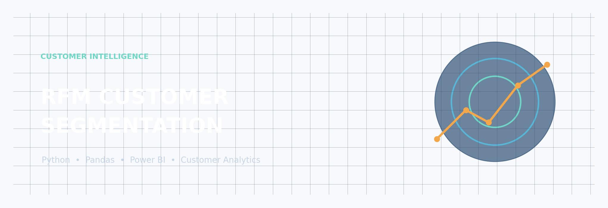
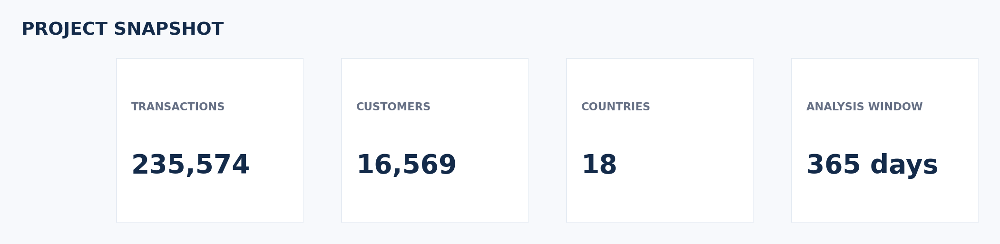
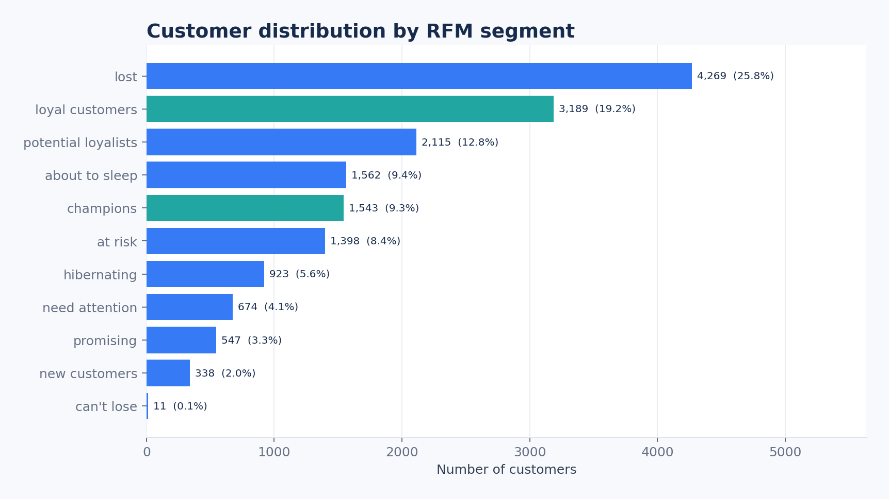
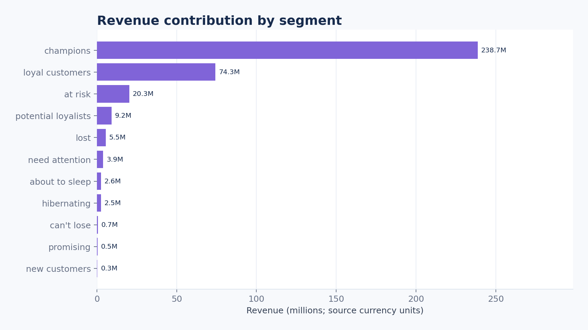
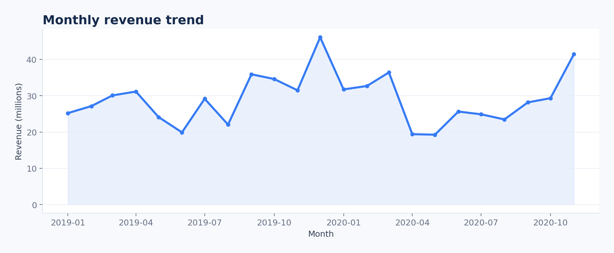
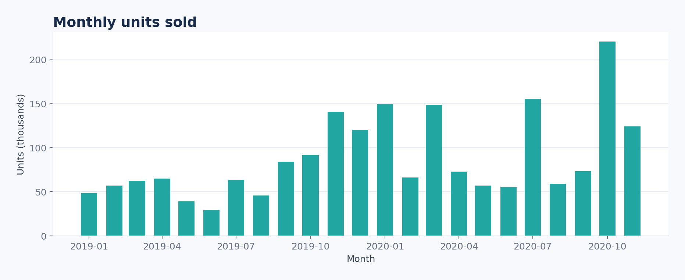
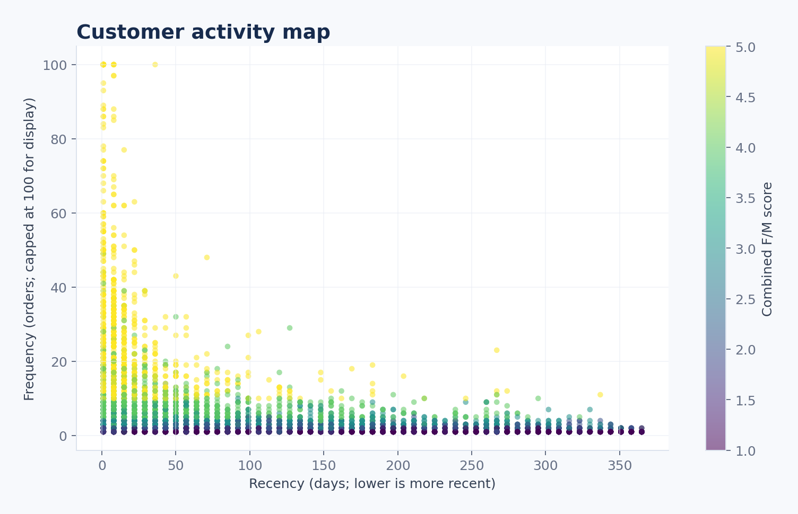
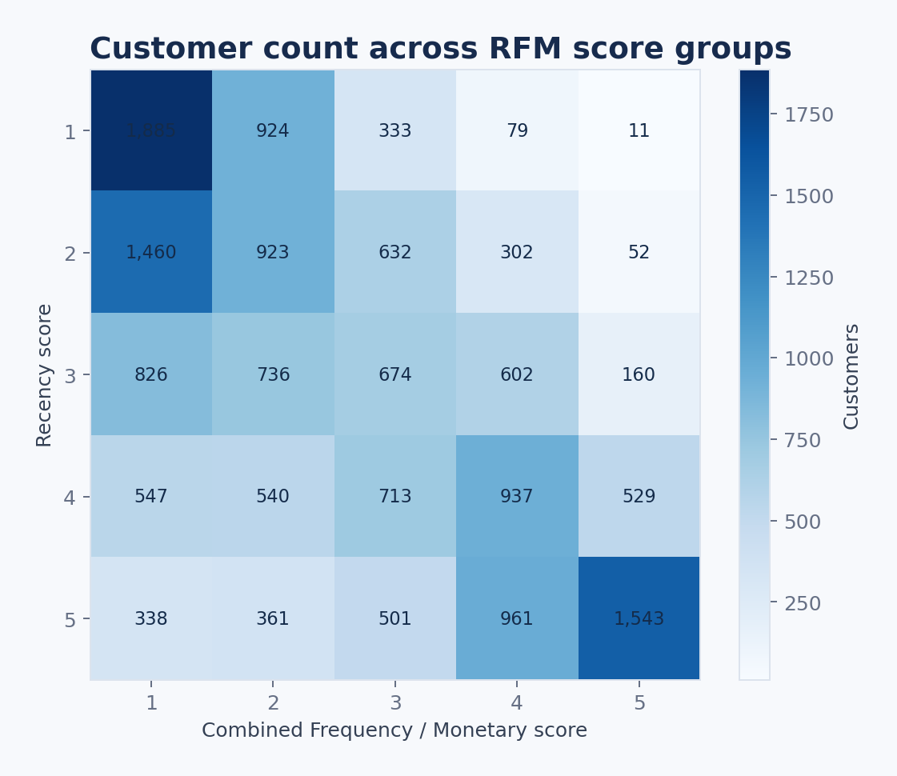
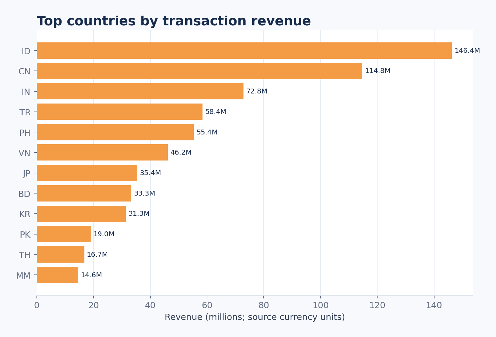
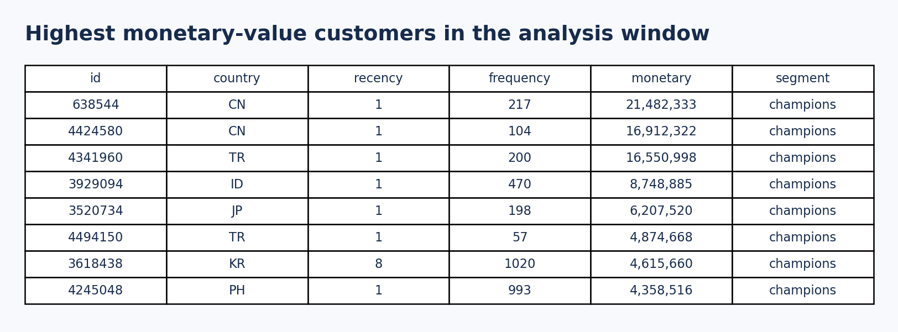

# RFM Customer Intelligence

A customer analytics project that turns transaction-level sales data into actionable customer segments using **Recency, Frequency and Monetary (RFM) analysis**. The workflow uses Python for data preparation and segmentation, then provides a Power BI report for interactive exploration.



<p align="center">
  
</p>

## Project at a glance

| Area | Details |
|---|---|
| Business problem | Understand customer value and identify retention opportunities |
| Analytical approach | RFM scoring with quintile-based scores |
| Analysis window | Latest 365 days in the transaction dataset |
| Customer segments | 11 behavioural segments |
| Python stack | Python, Pandas, NumPy, Matplotlib |
| Reporting | Microsoft Power BI |

## What this project answers

- Which customers are the most recently active?
- Who purchases most frequently?
- Which customers contribute the highest recorded revenue?
- Which valuable customers may be at risk of becoming inactive?
- How does the customer mix differ across RFM segments and countries?

## Repository structure

```text
RFM-Customer-Intelligence/
├── code/
│   ├── customer_segmentation_asia.ipynb  # Exploratory notebook and RFM workflow
│   └── run_analysis.py                   # Rebuilds customer-level RFM output
├── data/
│   └── sales_asia.csv                     # Source transaction data
├── media/                                 # Project visuals and analytical charts
├── output/
│   ├── rfm_asia.csv                       # Customer-level RFM dataset
│   └── customer_segmentation.pbix         # Power BI report
├── requirements.txt
└── README.md
```

## Dataset

The bundled dataset contains **235,574 transaction rows** across **18 country codes**, covering **7 January 2019 to 30 November 2020**. The source file uses a semicolon (`;`) delimiter and a comma decimal separator. The original dataset description indicates that country names, customer identifiers and revenue values were modified for privacy.

Each row represents a sales transaction and includes:

| Field | Description |
|---|---|
| `country` | Country code associated with the transaction |
| `id` | Customer identifier within the country |
| `week.year` | Transaction week and year |
| `revenue` | Recorded transaction revenue |
| `units` | Number of units in the transaction |

**Data note:** Transaction revenue and units include negative values, which may represent returns or adjustments. They are retained rather than silently removed.

## Methodology

### 1. Prepare transactions

- Read the source CSV using its original delimiter and decimal format.
- Convert the week/year field into a date.
- Rename `revenue` to `monetary` for consistency with RFM terminology.
- Restrict customer-level calculations to the latest 365-day period relative to the final transaction date.

### 2. Build customer-level metrics

A composite customer key is formed from country code and customer ID to avoid combining equal numeric IDs from different countries. The metrics are:

| Metric | Definition | Interpretation |
|---|---|---|
| Recency | Days since the customer's latest purchase | Lower is better |
| Frequency | Number of transaction rows in the analysis window | Higher is better |
| Monetary | Sum of recorded revenue in the analysis window | Higher is better |

### 3. Score and segment customers

Each R, F and M metric is scored from 1 to 5 using quintile thresholds. Recency is reverse-scored, so a more recent purchase receives a higher score. Frequency and Monetary are scored in ascending order. Frequency and Monetary scores are then averaged and truncated to create a combined `FM` score. The `R` and `FM` scores map customers into 11 business-facing segments.

## Analytical visuals

### Customer distribution



### Revenue contribution by segment



### Monthly revenue trend



### Monthly units sold



### Customer activity map

The frequency axis is capped at 100 **for display only** so that the dense customer population remains readable. The underlying RFM output retains the original frequency values.



### RFM score matrix



### Country revenue comparison



### High monetary-value customer examples



## Run the analysis

### Requirements

- Python 3.9 or newer
- pip

### Install dependencies

```bash
pip install -r requirements.txt
```

### Rebuild the RFM dataset

Run from the repository root:

```bash
python code/run_analysis.py
```

The script reads `data/sales_asia.csv`, recalculates the customer-level metrics and writes the result to `output/rfm_asia.csv`. The notebook in `code/` provides the step-by-step exploratory workflow.

## Power BI report

Open [`output/customer_segmentation.pbix`](output/customer_segmentation.pbix) in Power BI Desktop. If prompted, point the report to the refreshed `output/rfm_asia.csv` file. The report is supplied as a PBIX artifact; the static charts in this README are generated from the bundled transaction and RFM data and are not screenshots of the PBIX interface.

## Segment guide

| Segment | Typical behaviour | Suggested business action |
|---|---|---|
| Champions | Recent, frequent and high-value customers | Reward loyalty and encourage advocacy |
| Loyal Customers | Repeat purchasers with strong combined value | Retain with relevant benefits |
| Potential Loyalists | Recent customers with developing purchase habits | Encourage a second or repeat purchase |
| Recent Customers | Recently active but not yet frequent | Build engagement and onboarding |
| Promising | Recent customers with lower spend or frequency | Nurture with relevant recommendations |
| Need Attention | Mid-range recency and value | Test targeted reactivation |
| About To Sleep | Activity is cooling | Reach out before inactivity deepens |
| At Risk | Less recent customers with prior value | Run win-back campaigns |
| Can't Lose | High F/M score but very low recency score | Prioritise personalised recovery |
| Hibernating | Long time since purchase and low F/M score | Use low-cost reactivation tests |
| Lost | Low recency and low F/M scores | Limit spend; test only economical campaigns |

Segments describe behaviour in this dataset and should not be treated as permanent customer traits. Thresholds depend on the analysis window and the dataset distribution.

## Limitations and interpretation

- Frequency is calculated as the count of transaction rows because the source description treats each row as an order.
- Monetary value is the sum of recorded revenue, including negative adjustments.
- The dataset is anonymised/modified; currency and customer identities should not be inferred.
- Quintile scoring is relative to this dataset and period, not a universal benchmark.
- The analysis is descriptive and does not predict future churn or customer lifetime value.

## References

- [RFM Segmentation with Python — Guillaume Martin](https://guillaume-martin.github.io/rfm-segmentation-with-python.html)
- [Google Cloud — Predicting Customer Lifetime Value](https://cloud.google.com/architecture/clv-prediction-with-offline-training-intro#overview)

---

*Built as a practical customer analytics and business intelligence project.*
